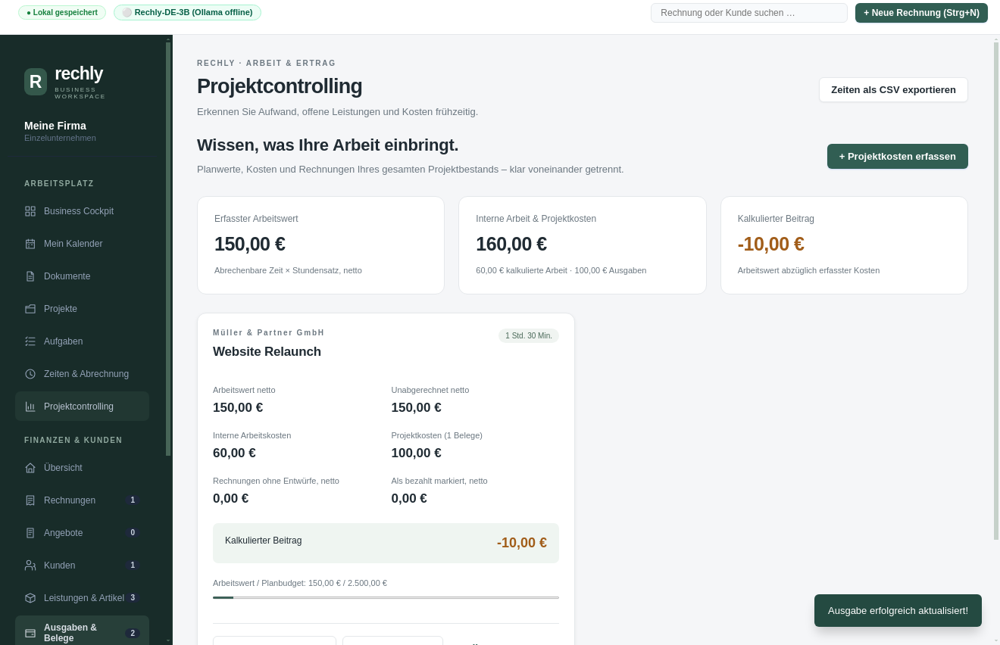

# Rechly Desktop — Offline Business Workspace

[](LICENSE)
[](https://github.com/myaxyo/rechly_desktop/releases/latest)

**Rechly Desktop** is the standalone, fully offline, privacy-first desktop edition of [Rechly](https://rechly.de) for macOS and Windows. It is free and open source under the AGPL-3.0.

---

## ⬇️ Download

| Platform | Download |
| --- | --- |
| Windows 10/11 (64-bit) | [Rechly-Desktop-Setup-win-x64.exe](https://github.com/myaxyo/rechly_desktop/releases/latest/download/Rechly-Desktop-Setup-win-x64.exe) |
| macOS Apple Silicon (M1 and newer) | [Rechly-Desktop-mac-arm64.dmg](https://github.com/myaxyo/rechly_desktop/releases/latest/download/Rechly-Desktop-mac-arm64.dmg) |
| macOS Intel | [Rechly-Desktop-mac-x64.dmg](https://github.com/myaxyo/rechly_desktop/releases/latest/download/Rechly-Desktop-mac-x64.dmg) |

All versions: [Releases](https://github.com/myaxyo/rechly_desktop/releases).

> Downloads reflect the last published release, not unpublished source changes. For the “damaged” Mac error, local builds and signing verification, see [Local builds](docs/LOCAL-BUILDS.md). Public Mac distribution requires Developer ID signing and notarization; Windows signing is configured separately.

---

## 🌟 Key Desktop Features

* **Offline core workflows:**
  - All invoices, clients, products, offers, expenses, and company profiles are stored locally in SQLite (`rechly.sqlite`) with atomic transactions and startup integrity checks. Existing JSON data migrates automatically; the original files are retained.
  - No internet connection, cloud login, or remote Appwrite server required for business workflows. Optional cloud AI requires opt-in; local Ollama can be used instead.
  - The business database is not encrypted; use FileVault or BitLocker for device protection. API keys use OS-protected storage. Portable backups require a password and use authenticated encryption. Offline storage alone does not establish GoBD or DSGVO compliance.
* **Featured AI Model: [`jonprompter/Rechly-DE-3B`](https://ollama.com/jonprompter/Rechly-DE-3B):**
  - Pre-configured to connect to local Ollama on `http://localhost:11434`.
  - Natural Language **"Text-zu-Rechnung"** (type e.g. *"Rechnung an Müller GmbH: 10 Std. Beratung à 120€, zahlbar in 14 Tagen mit 2% Skonto"* and the AI populates the invoice draft in 1 click).
  - Also available on [Hugging Face](https://huggingface.co/jonprompter/rechly-de-3b).
  - Terminal 1-liner to run:
    ```bash
    ollama run jonprompter/Rechly-DE-3B
    ```
* **Electronic invoice XML:**
  - CII XML export intended for XRechnung workflows. Validate exported files against the applicable schema and business rules before submission; automated conformance certification and hybrid PDF/A-3 invoices are not established by this repository.
  - Native file save dialog directly to your preferred folder.
* **DATEV Buchungsstapel Export:**
  - Generates standard DATEV EXTF format 700 CSV files for German tax consultants (*Steuerberater*).
* **Native Desktop Experience:**
  - macOS frameless window with native traffic-light controls.
  - Collapsible Linear/Notion-style desktop sidebar.
  - Keyboard shortcuts (`⌘N` for New Invoice, `⌘F` for Search, `⌘P` for Print/PDF).
  - 1-Click Vault Backup & Restore.

---

## New in source version 1.2.0: work becomes an invoice

Open **Zeiten & Abrechnung** in the sidebar. Create a customer-linked project, record work with a persistent timer or manual entries, select the billable entries and generate an invoice draft. Billed times are protected against accidental duplicate billing. CSV export keeps your time records portable.

Open **Projektcontrolling** to see work value, internal labor costs, project expenses, unbilled work, invoices and amounts marked paid. Add costs directly or assign existing expenses from **Ausgaben & Belege**. Estimates and payment statuses are labelled explicitly; the report is not a tax-profit calculation.

The start page links to the workflow, a running timer remains visible across screens, and the installed version appears in the sidebar and **Hilfe → Über Rechly Desktop**. Timers persist across restarts; verify the elapsed duration before saving. New data uses the existing local vault and backup process.

See the [1.2.0 changes](docs/RELEASE-1.2.0.md) and [prioritized product direction](docs/PRODUCT-DIRECTION.md).



[View the time and billing screen](docs/images/time-billing.png).

## Business Workspace

The app now opens in a German-language business cockpit alongside the existing invoice workflows:

- **Documents:** create business letters, meeting minutes and notes from editable templates, link them to projects, search their contents and export A4 PDF or UTF-8 text files.
- **Projects:** connect work to customers, set target dates and planned budgets, and track completion from linked tasks.
- **Tasks:** organize work across Offen, In Arbeit and Erledigt; record responsible people, priorities and deadlines.
- **Overview:** see active projects, open and overdue tasks, upcoming work and document counts.

Choose **Speichern** to persist edits. Closing an editor with unsaved changes asks before discarding them. Tasks and documents must be unlinked before their project can be deleted. These records use the local SQLite database and are included in encrypted portable backups. Older vaults start with empty workspace collections.

This workspace is designed for a single local user. Responsible-person fields are labels, not user accounts or notifications. Documents currently contain plain text; DOCX/XLSX editing, spreadsheets, real-time collaboration and role-based access are not implemented. Project budgets are planning figures, not recognized revenue or accounting entries.

## Persönlicher Offline-Kalender

- Monats-, Wochen-, Tages- und Agendaansicht mit deutscher Wochenstruktur (Montag zuerst).
- Termine mit Ort, Notizen, Kategorien, ganztägigen Zeiträumen und Suchfunktion.
- Tägliche, wöchentliche, monatliche oder jährliche Serien mit Intervall und optionalem Enddatum. Einzelne Vorkommen oder ganze Serien lassen sich löschen; Bearbeitungen betreffen die gesamte Serie.
- Aufgaben und offene Rechnungsfristen können eingeblendet werden; die verknüpften Einträge öffnen ihren ursprünglichen Arbeitsbereich.
- Lokale Systemerinnerungen, solange Rechly läuft. Das Betriebssystem muss Benachrichtigungen erlauben. Nach längerer Schließzeit werden verpasste Erinnerungen nicht nachträglich gesammelt angezeigt.
- ICS-Import mit Vorschau der Anzahl und Bestätigung, Duplikaterkennung anhand der UID und ICS-Export. Unterstützt werden lokale Zeiten, einzelne UTC-Termine und einfache Wiederholungen. TZID-Zeitzonen, COUNT/BYDAY-Regeln, einzelne Serienänderungen und zusätzliche Serientermine werden mit einer Fehlermeldung abgelehnt, damit keine Terminsemantik verloren geht.

Termine verwenden die Gerätezeitzone. Es gibt keine Konten, Teilnehmer-Einladungen, Freigaben oder Synchronisierung. Bei ganztägigen Terminen ist das Enddatum im Editor einschließlich; intern und im ICS-Export ist das Ende wie im Kalenderstandard ausschließlich. Ein Termin kann bis zu 31 Tage dauern. Alle Kalenderdaten sind Bestandteil der lokalen Tresor-Sicherung.

## Data storage and recovery

JSON is still used to serialize individual records and backup content, but the active database is SQLite: records live in separate entity tables and changed rows commit together with a write-ahead log. The app no longer rewrites one JSON document for every edit.

**Settings → Lokale Daten & Sicherungen** shows the storage path and protection limits. New backup exports use AES-256-GCM and a password-derived key (scrypt). Restore requires a validated preview, and a local snapshot is saved before replacement. Legacy JSON and local SQLite recovery snapshots can also be restored. Damaged or unsupported databases open a recovery screen instead of silently loading sample data.

API keys are protected using the operating system's secure storage and omitted from portable backups. The business database, local recovery copies and retained old JSON files are **not encrypted**. Keep your device protected and store an encrypted backup on another drive. The app cannot recover a forgotten backup password.

See [storage, migration and recovery details](docs/STORAGE.md).

## Desktop builds

GitHub Actions builds Windows x64, macOS Intel and macOS Apple Silicon on native runners. Each job runs type checking, unit tests, desktop workflow tests, builds its installer and launches the packaged app for calendar and time-billing workflow tests. After all three platform jobs pass on `main`, the release job publishes the new package version with SHA-256 checksums. Existing releases are never overwritten. Installers are also retained as build artifacts. Mac builds now use an ad-hoc signature if no certificate is available, and verify bundle integrity. Developer ID signing and notarization are required for trusted Mac distribution. Windows signing is separately configured. See [Local builds](docs/LOCAL-BUILDS.md) for the verification procedure.

## 🚀 Running the App Locally

Use [Node.js](https://nodejs.org) 22 LTS (also used in CI).

```bash
git clone https://github.com/myaxyo/rechly_desktop.git
cd rechly_desktop
npm ci
npm start
```
The main process is written in TypeScript (`src/`) and compiled to `out/` by `npm run build`; `npm start` and the `dist` scripts build automatically. Use `npm run typecheck` for a type check without emitting files.

---

## 📦 Building Installers (.dmg / .exe)

On a MacBook, follow the [local build and signing guide](docs/LOCAL-BUILDS.md). Quick commands:

```bash
# Apple Silicon Mac (use --x64 for Intel)
npm run dist:mac -- --arm64 --publish never
node scripts/verify-macos.cjs

# Windows x64; cross-building on macOS may require Wine
npm run dist:win -- --x64 --publish never
```

Files are written to `dist/`. Windows installers need Windows testing; Mac signatures and Gatekeeper checks need macOS. The guide covers native CI builds, notarization and verification of the installed copy.

---

## 🤝 Contributing

Bug reports, feature ideas and pull requests are welcome. See [CONTRIBUTING.md](CONTRIBUTING.md).

---

## 📄 License

Copyright © 2026 Rechly

Rechly Desktop is free software: you can redistribute it and/or modify it under the terms of the [GNU Affero General Public License v3.0](LICENSE) as published by the Free Software Foundation (version 3 only).

This program is distributed in the hope that it will be useful, but WITHOUT ANY WARRANTY; without even the implied warranty of MERCHANTABILITY or FITNESS FOR A PARTICULAR PURPOSE. See the [LICENSE](LICENSE) for details.
